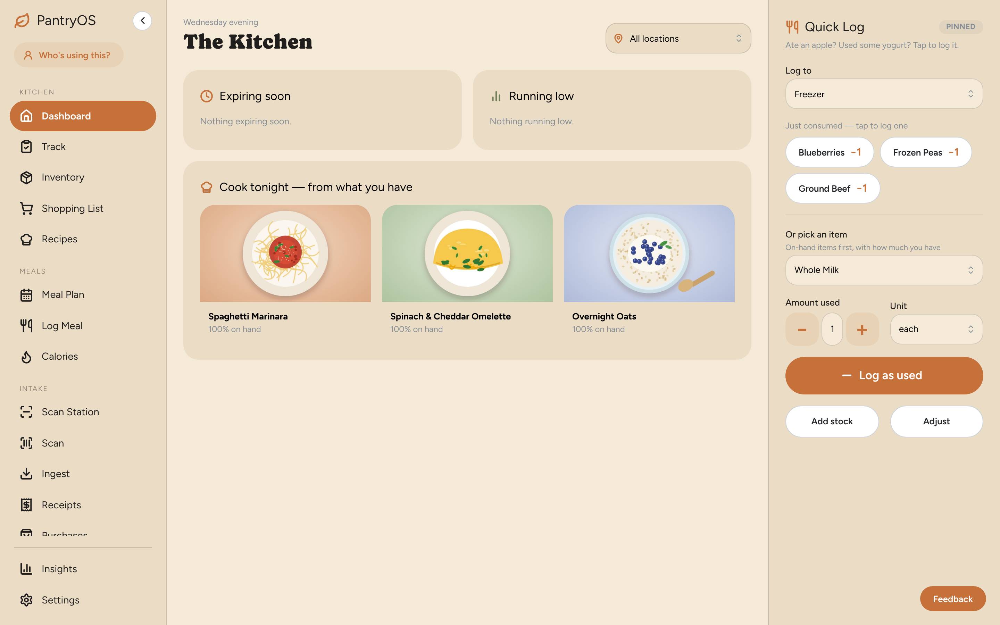
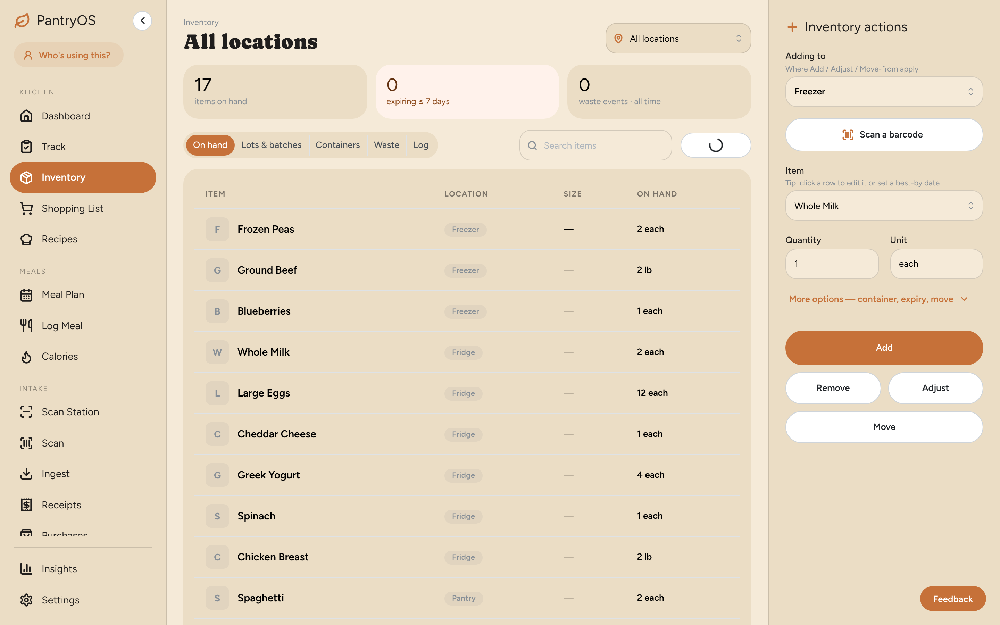
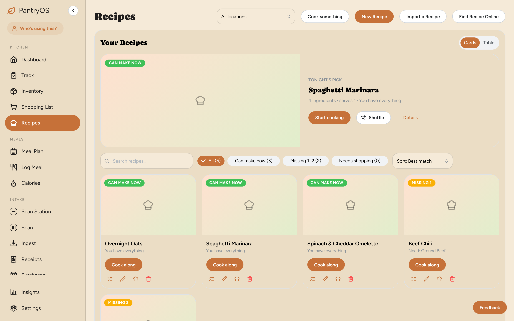

<div align="center">

# 🥫 PantryOS

**Know what's in your kitchen, cook what you have, waste less.**

A self-hosted home for your household's food — inventory, recipes, meal
planning and shopping in one app that runs on your own hardware.

[](https://github.com/Wildstone-Systems/wildstone-pantry/actions/workflows/ci.yml)
[](LICENSE)
[](https://github.com/Wildstone-Systems/wildstone-pantry/releases)

[Quick install](#-quick-install) · [Features](#-features) · [Docs](docs/README.md) · [Contributing](CONTRIBUTING.md)



</div>

## ✨ Features

- **🏠 Kitchen dashboard** — what's expiring, what's running low, and what you
  can cook tonight, at a glance.
- **📦 Inventory** — track stock across fridge, freezer, pantry and more.
  Lots, containers, best-by dates, waste and a full history.
- **📷 Fast intake** — scan barcodes, import receipts (text, photo or email)
  and purchase history.
- **🍝 Recipes** — see what you can make now, import recipes from the web, and
  cook along step by step. Cooking takes ingredients out of stock for you.
- **📅 Meal planning** — plan the week, see nutrition, and send missing
  ingredients straight to the shopping list.
- **🛒 Shopping list** — built from what you're low on and what you've planned.
- **🔥 Calorie tracking** — log meals and see daily totals.
- **🤖 AI assistant ready** — a built-in [MCP server](docs/mcp-and-agents.md)
  lets AI assistants check stock, plan meals and update your lists.
- **🔐 Your data stays home** — runs on your network. Optional
  [single sign-on](docs/sso-oidc-setup.md) with your existing identity provider.
- **📱 Installable** — works as a phone/tablet app (PWA).

<table>
  <tr>
    <td></td>
    <td></td>
  </tr>
  <tr>
    <td align="center"><b>Inventory</b></td>
    <td align="center"><b>Recipes</b></td>
  </tr>
</table>

## 🚀 Quick install

You need [Docker](https://docs.docker.com/get-started/get-docker/).

**Linux, NAS or Raspberry Pi** — one line (review the script first):

```bash
curl -fsSL https://raw.githubusercontent.com/Wildstone-Systems/wildstone-pantry/main/scripts/install-product.sh | bash
```

**Or with Docker Compose** from a checkout of this repo:

```bash
POSTGRES_PASSWORD=$(openssl rand -hex 24) \
CONFIG_SECRET_KEY=$(python3 -c "from cryptography.fernet import Fernet; print(Fernet.generate_key().decode())") \
docker compose -f docker-compose.product.yml up --build -d
```

Then open **<http://localhost:8420>** and follow the setup wizard.

> Windows/macOS desktop launcher, the no-source release bundle and other
> options: see [Getting started](docs/getting-started.md).

## 📚 Documentation

| Guide | |
|---|---|
| [Getting started](docs/getting-started.md) | All install options and first run |
| [Olares](deploy/olares/pantryos/README.md) | Install PantryOS as a shared Olares app |
| [Single sign-on (OIDC)](docs/sso-oidc-setup.md) | Authelia, authentik, Keycloak, Pocket ID |
| [AI assistants (MCP)](docs/mcp-and-agents.md) | Connect an AI assistant |
| [Long-lived deployments](docs/deployment.md) | Staging stack and secrets |
| [Development](docs/development.md) | Dev setup, tests, API reference |
| [Architecture](ARCHITECTURE.md) | How the code is organised |

## 🛠️ Built with

FastAPI · SQLAlchemy · PostgreSQL · React · Vite · Mantine — organised as a
[modular monolith](ARCHITECTURE.md).

## 🤝 Contributing

Contributions are welcome! Start with [`CONTRIBUTING.md`](CONTRIBUTING.md) and
[Development](docs/development.md).

Found a security issue? Please report it privately — see [`SECURITY.md`](SECURITY.md).

## 📄 License

[AGPL-3.0-or-later](LICENSE). If you run a modified version as a network
service, you must offer its source to its users.
